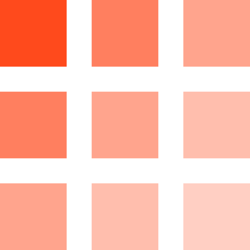

<div align="center">
  
  <h1>ninetile</h1>
  <p>hCaptcha tokens and recognition answers through one API.</p>

  <a href="https://github.com/Ninetile-io/ninetile/actions/workflows/test-python.yml"></a>
  <a href="https://github.com/Ninetile-io/ninetile/actions/workflows/test-js.yml"></a>
  <a href="https://pypi.org/project/ninetile/"></a>
  <a href="https://www.npmjs.com/package/ninetile"></a>
  <a href="https://github.com/Ninetile-io/ninetile/blob/main/LICENSE"></a>
</div>

Send a sitekey and URL, get back a `P1_` token your form can submit — or send a challenge's images and get back where to click.

## Two APIs

| | Token API | Recognition API |
|---|---|---|
| Returns | a `P1_` token, ready to submit | tile selections, click points or drag boxes |
| Endpoint | `POST https://api.ninetile.io/v1/solves` | `POST https://api.ninetile.io/v1/recognize` |
| For | integrations that want the whole challenge solved | integrations that run their own browser and only need the answer |
| Price | **$0.75 per 1,000** successful tokens | **$0.30 per 1,000** successful answers |

Prepaid USD. Failed, cancelled and expired solves and unanswerable puzzles are never charged.

## Install

```sh
pip install ninetile          # Python 3.9+, httpx
npm install ninetile          # Node 18+, zero dependencies
```

Get a key from the [dashboard](https://ninetile.io/dashboard) — it is shown once and stored hashed. Send it as `Authorization: Bearer nt_live_…`.

## Quick start

**Python** — sync or async, same surface:

```python
from ninetile import NinetileClient

client = NinetileClient()                       # reads NT_API_KEY
solve = client.solve("f5ab1c2d-7e8f-4a9b-b1c2-d3e4f5a6b7c8", "https://example.com/login", wait=30)

print(solve.status, solve.token)                # solved P1_…
print(solve.user_agent)                         # submit the token with exactly this
```

```python
from ninetile import AsyncNinetileClient

async with AsyncNinetileClient() as client:
    solve = await client.solve("…", "https://example.com/login", wait=30)
```

**JavaScript / TypeScript**:

```ts
import { NinetileClient } from "ninetile";

const client = new NinetileClient();             // reads NT_API_KEY
const solve = await client.solve("f5ab1c2d-7e8f-4a9b-b1c2-d3e4f5a6b7c8", "https://example.com/login", { wait: 30 });

console.log(solve.status, solve.token, solve.userAgent);
```

**curl**:

```sh
curl "https://api.ninetile.io/v1/solves?wait=30" \
  -H "Authorization: Bearer $NT_API_KEY" \
  -H "Content-Type: application/json" \
  -d '{"type":"hcaptcha","sitekey":"f5ab1c2d-7e8f-4a9b-b1c2-d3e4f5a6b7c8","url":"https://example.com/login"}'
```

Without `?wait` a create returns `202` with an id; poll `GET /v1/solves/{id}`. A solved response carries `token` and the `user_agent` the solve ran as — submit the token with exactly that User-Agent. Tokens are single-use and short-lived.

## Browser identity

Do not send a `user_agent`. A solve presents one coherent browser identity — User-Agent, `Sec-CH-UA` client hints and platform have to agree — so the API refuses a supplied one with `422 validation_error` (`param: "user_agent"`) rather than minting a token whose fingerprint contradicts itself. Submit the token with the `user_agent` the solve returns; an empty string is treated as omitted.

Tokens are minted from our egress IPs. A target that verifies the submitting IP (`remoteip`) can still reject a token hCaptcha itself considered valid — that is a limit of any hosted solver. If your target is strict about IP, pass your own `proxy`.

## Errors

Every non-2xx response has the same shape:

```json
{ "error": { "code": "insufficient_credits", "message": "…", "param": null, "request_id": "…" } }
```

An accepted solve can still end without a token: it comes back with `status: failed` and an `error` object carrying `code`, `message`, `reason` and `retryable` — never an HTTP error, and never charged. Retry only when `retryable`, and honour `Retry-After`.

## SDKs

| Language | Package | Source |
|---|---|---|
| Python | [`ninetile`](https://pypi.org/project/ninetile/) | [`python/`](python/) |
| JavaScript / TypeScript | [`ninetile`](https://www.npmjs.com/package/ninetile) | [`javascript/`](javascript/) |

Both handle polling, timeouts and the error taxonomy, and both refuse to retry a create call — a retry is a new solve and a new charge.

## Compatibility routes

The same key works on `/compat/2captcha` (`in.php`/`res.php`), `/compat/capsolver`, `/compat/anticaptcha`, `/compat/capmonster` and `/compat/nopecha`. Only hCaptcha task types are served; anything else is refused in that dialect's own error format.

## Documentation

[ninetile.io/docs](https://ninetile.io/docs) · [API reference](https://ninetile.io/docs/api-reference/create-solve) · [Dashboard](https://ninetile.io/dashboard) · [Status](https://api.ninetile.io/v1/status)

## License

MIT — see [LICENSE](LICENSE).
